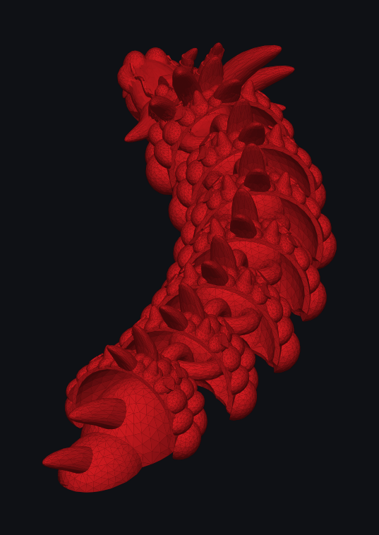
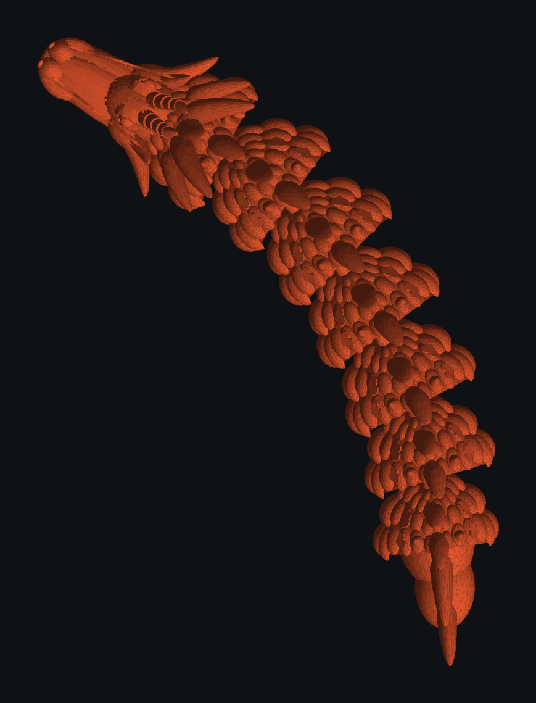
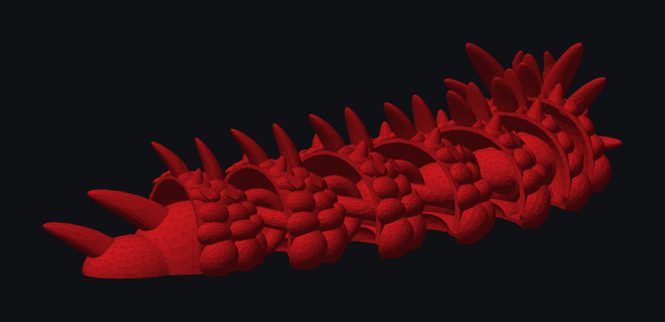

# Articulated Dragon

A print-in-place articulated dragon designed in **Tinkercad**. The spine is a chain of linked segments which I had to read a few articles for to udnerstand linking in TinkerCAD. The scales and spikes were made using open sourced shapes; for example the spikes were made with someones open sourced pepper model. Every segment is a separate interlocking piece, so the whole dragon prints in one go and comes off the bed already able to bend and wiggle, for most 3D printers.

### **[▶ Live 3D demo](https://claire-yuan-xi.github.io/articulated-dragon/)**



## Features
- **Print-in-place:** prints as one job, and the joints move straight off the bed
- **145 interlocking parts** in a single STL file
- **Compact:** about 190 × 140 × 41 mm as laid out (posed in a curve, so it fits on most printer beds)
- **Detailed:** about 569,000 triangles of scales, spikes, horns and tail
- Modeled entirely in Tinkercad

## Gallery
| Top view | Side view |
|---|---|
|  |  |

## Live demo
The [demo page](https://claire-yuan-xi.github.io/articulated-dragon/) loads the actual STL file in your browser with [three.js](https://threejs.org/):
- drag to rotate, scroll to zoom, right-drag to pan
- change the color of the dragon
- turn on a wireframe view to see the mesh
- pause or resume the turntable spin

## Files
| File | Description |
|---|---|
| [`models/dragon.stl`](models/dragon.stl) | The full print-in-place dragon (binary STL, ~28 MB) |
| [`index.html`](index.html) | The 3D viewer behind the live demo |
| `images/` | Rendered preview images |

## Printing tips
- Print it flat and as exported
- Don't add supports, as they will fill the gaps between segments and fuse the joints.
- A 0.2 mm layer height works well with PLA.
- When the print is done, gently flex each joint from head to tail to free it, or if the printer auto adds supports, use pliers to take the extra PLA off.

## Run the demo locally
```bash
git clone https://github.com/claire-yuan-xi/articulated-dragon.git
cd articulated-dragon
python3 -m http.server 8000
# then open http://localhost:8000
```
(Opening `index.html` by double-clicking it won't work; browsers block loading the STL from `file://`.)

---
Designed by **Claire Yuan**
